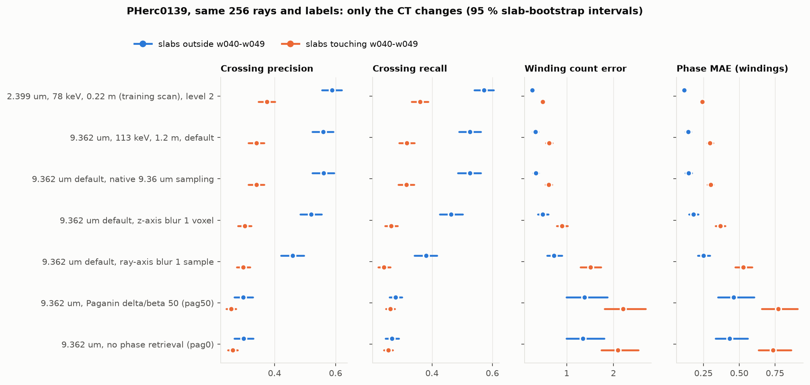
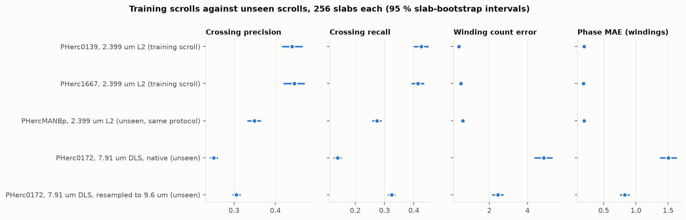
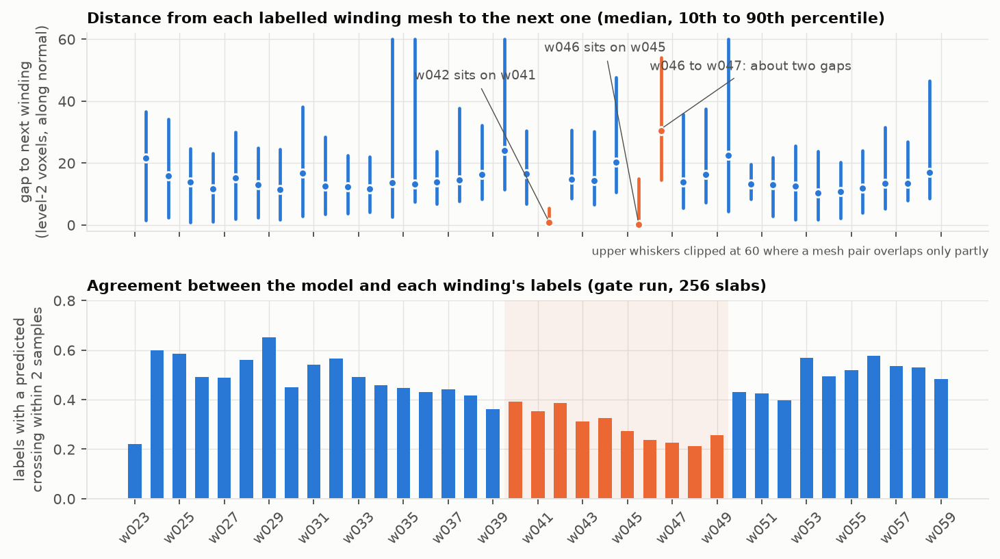
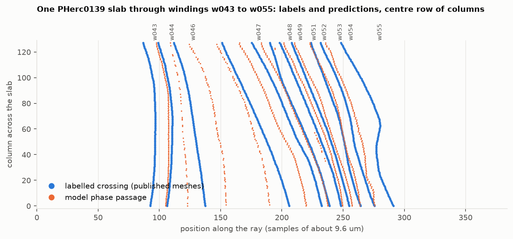

# winding_model_9um on held-out scans and scrolls

**Summary.** On fresh draws from its own training scans, `scrollprize/winding_model_9um` matches its training log only where the PHerc0139 labels are clean. On the eligible-protocol 9.362 um scan of the same sheets it loses 0.03 precision and 0.04 recall, with count error up 0.11. Weaker phase retrieval (`pag50`, `pag0`) and an unseen 7.91 um DLS scan break it, with winding count error above 1.8 per column.

All numbers below come from villa's own dataset, losses and metric code (`WindingModelDataset`, `compute_losses`, `accumulate_winding_metrics` and `finalize_winding_metrics` in `train_winding_model.py`, at commit `e0bbb8b`), run unchanged on an Apple M4 Max. Each condition uses 256 fresh slabs (rays) drawn the way `validation_mode: "separate"` draws them. Intervals are 95 % slab bootstraps; "change" intervals are paired bootstraps over identical slabs.

## What was evaluated

| Item | Value |
|---|---|
| Model | `scrollprize/winding_model_9um`, `ckpt_final.pth` (run `winding_model_3d_large_11`, step 50000), weights `model`, fp32 |
| Published metrics | `metrics.jsonl`, logged with `validation_mode: "train_batch"`: in-sample, pooled over PHerc0139, PHerc1667 and PHercParis4. Last row: precision 0.538, recall 0.517, count error 0.341, phase MAE 0.137. Last 20 rows: 0.558, 0.527, 0.385, 0.128 |
| Metrics | crossing precision and recall (decoded integer phase passages matched to labelled crossings within 2 samples); winding count error (absolute difference between predicted and labelled phase change over each supervised column); phase MAE (one free offset per slab) |
| Slab | 128 x 128 transverse x 384 along the ray, one sample per training voxel (about 9.6 um), every column scored |
| Region | ray origins restricted to one z band per scroll (PHerc0139: level-2 z 3904 to 4288); all segments stay loaded, so brackets and labels are unchanged |
| Hardware | Apple M4 Max, 128 GB unified memory, PyTorch 2.14.1 on MPS |

## 1. Reproducing the training distribution

PHerc0139 2.399 um 78 keV scan at level 2 with the published `-on-20260102150214-2.399um` meshes, divided by 4 to the level-2 units the released config expects.

| Slabs | n | Precision | Recall | Count error | Phase MAE |
|---|---|---|---|---|---|
| all | 256 | 0.440 (0.417 to 0.464) | 0.426 (0.402 to 0.449) | 0.405 (0.370 to 0.442) | 0.196 (0.182 to 0.209) |
| bracket outside w040 to w049 | 94 | 0.588 (0.556 to 0.620) | 0.573 (0.541 to 0.604) | 0.260 (0.223 to 0.299) | 0.116 (0.102 to 0.131) |
| bracket touching w040 to w049 | 162 | 0.375 (0.347 to 0.401) | 0.361 (0.333 to 0.388) | 0.488 (0.444 to 0.535) | 0.242 (0.225 to 0.258) |
| training log, last 20 rows | | 0.558 (sd 0.057) | 0.527 (sd 0.055) | 0.385 (sd 0.197) | 0.128 (sd 0.045) |

Outside windings w040 to w049 the evaluation lands on the training log; inside that band it does not (section 5). PHerc1667, the second training scroll (2.399 um level 2, 19 segments), gives 0.446 (0.420 to 0.472), 0.414 (0.393 to 0.435), 0.506 (0.416 to 0.600) and 0.187 (0.164 to 0.211). EMA weights (0.441, 0.426, 0.405, 0.196) and bf16 autocast (0.446, 0.429, 0.394, 0.194) agree with fp32 on the same slabs; MPS and CPU agree to four decimals; a rerun reproduces all 256 per-slab sums bit for bit.

## 2. Same sheets, eligible-protocol scan and its reconstructions (condition 2)

The fine 2.399-frame meshes stay in place and only the CT changes. `windeval/replay.py` draws each slab and its labels from the 2.399 run, then re-samples the image from PHerc0139's 9.362 um, 1.2 m, 113 keV scan through an affine fitted by CT block matching. The fit used 300 blocks of 48^3 voxels on mesh vertices, phase correlation and robust least squares; median block NCC was 0.95. Residual shifts under the published `transform.json` were 1.05 voxels median; under the fit they are 0.10 median, 0.23 p90 and 0.10 held out (`results/transform_pherc0139_2399l2_to_9362*.json`). The 256 rays and label counts are identical to section 1, slab by slab. `pag0` and `pag50` are reconstructions of the same acquisition; they are voxel-aligned with the default one (phase correlation, zero shift at levels 0 and 2).

| CT (same rays and labels) | Slabs | Precision | Recall | Count error | Phase MAE |
|---|---|---|---|---|---|
| 2.399 um, 78 keV, 0.22 m, Paganin delta/beta 1000 (training scan) | all | 0.440 (0.417 to 0.464) | 0.426 (0.402 to 0.449) | 0.405 (0.370 to 0.442) | 0.196 (0.182 to 0.209) |
| | outside band | 0.588 | 0.573 | 0.260 | 0.116 |
| | touching band | 0.375 | 0.361 | 0.488 | 0.242 |
| 9.362 um, 113 keV, 1.2 m, delta/beta 1000 (default) | all | 0.409, change -0.032 (-0.047 to -0.017) | 0.381, -0.044 (-0.061 to -0.029) | 0.518, +0.113 (+0.060 to +0.164) | 0.240, +0.044 (+0.031 to +0.057) |
| | outside band | 0.559, -0.029 (-0.057 to +0.001) | 0.526, -0.046 (-0.077 to -0.014) | 0.332, +0.072 (+0.013 to +0.134) | 0.143, +0.027 (+0.011 to +0.043) |
| | touching band | 0.341, -0.033 (-0.052 to -0.016) | 0.317, -0.044 (-0.062 to -0.025) | 0.625, +0.137 (+0.064 to +0.214) | 0.295, +0.054 (+0.037 to +0.072) |
| 9.362 um, delta/beta 50 (`pag50`) | all | 0.269, -0.171 (-0.195 to -0.146) | 0.267, -0.158 (-0.182 to -0.133) | 1.904, +1.499 (+1.190 to +1.833) | 0.659, +0.463 (+0.375 to +0.561) |
| | outside band | 0.297, -0.291 | 0.279, -0.294 | 1.380, +1.120 (+0.734 to +1.609) | 0.462, +0.346 |
| | touching band | 0.258, -0.117 | 0.262, -0.099 | 2.207, +1.719 (+1.308 to +2.204) | 0.773, +0.531 |
| 9.362 um, no phase retrieval (`pag0`) | all | 0.273, -0.167 (-0.191 to -0.145) | 0.259, -0.167 (-0.190 to -0.144) | 1.819, +1.415 (+1.125 to +1.705) | 0.625, +0.430 (+0.351 to +0.515) |
| | outside band | 0.298, -0.290 | 0.267, -0.305 | 1.347, +1.087 (+0.744 to +1.540) | 0.434, +0.318 |
| | touching band | 0.263, -0.112 | 0.255, -0.106 | 2.093, +1.604 (+1.248 to +2.056) | 0.736, +0.495 |

*Figure 1. PHerc0139, 256 identical rays and labels per row; dots are pooled metrics, bars 95 % slab-bootstrap intervals, split by whether a slab's labelled bracket touches windings w040 to w049. Source: `results/compare_pherc0139_scans.json`.*

**Reconstruction sensitivity.** The three 9.362 um volumes come from one acquisition and differ only in reconstruction (`metadata.json`: Paganin delta/beta 1000 with unsharp masking 4 / 1.2; delta/beta 50 with the same unsharp masking; delta/beta 0.0001 without it). The training scans all use delta/beta 1000 with unsharp masking. With weaker phase retrieval the model counts 1.4 to 1.5 extra windings per column on these rays, and it does so on clean and difficult slabs alike. Spiral-fitting inputs should come from delta/beta 1000 reconstructions, or the model needs retraining on the other variants.

A first pass that used the 9.362-frame published meshes instead of the carried fine meshes gave 0.422, 0.389, 0.520 and 0.243 on the default scan: within noise of the fair result. The coarser mesh grid (187 um against 48 um) was not the issue. Measured along the sheet normal, those meshes sit 0.74 voxels (median) from the registered fine meshes.

## 3. Unseen scrolls (condition 3)

| Scroll and scan | Rays | Precision | Recall | Count error | Phase MAE |
|---|---|---|---|---|---|
| PHerc0841, 9.366 um and 2.403 um, 3 published segments | **0** | | | | |
| PHercMANBp, 2.399 um 78 keV level 2 (training protocol), w0 to w8 | 256 | 0.349 (0.334 to 0.364) | 0.274 (0.260 to 0.288) | 0.610 (0.548 to 0.673) | 0.196 (0.183 to 0.210) |
| PHerc0172 (Scroll 5), 7.91 um 53 keV DLS, native sampling, w052 to w095 | 256 | 0.251 (0.243 to 0.260) | 0.140 (0.129 to 0.151) | 4.854 (4.394 to 5.296) | 1.502 (1.380 to 1.622) |
| PHerc0172, resampled to 9.596 um | 256 | 0.306 (0.298 to 0.314) | 0.324 (0.314 to 0.335) | 2.447 (2.178 to 2.714) | 0.824 (0.758 to 0.895) |
| reference: PHerc0139 / PHerc1667 (training scrolls, section 1) | 256 each | 0.440 / 0.446 | 0.426 / 0.414 | 0.405 / 0.506 | 0.196 / 0.187 |

The w040 to w049 split is specific to PHerc0139's winding numbers and does not apply to these scrolls.

*Figure 2. Pooled metrics per scroll and scan with 95 % slab-bootstrap intervals. Source: `results/compare_scrolls.json`.*

- **PHerc0841 cannot be scored with the published labels.** Its three segments (`w00` and two `auto_grown_*`) are distinct sheets, each covering 0.77 to 0.78 of a turn, and only `w00` has a winding number. villa's sampler needs two labelled windings at least 4 apart, or a multi-wrap segment crossed twice. `windeval/count_rays.py` found 0 rays in 3,000 attempts on each scan, with no region limit, so widening the region does not help. The two scrolls above replace it: they are the only non-training scrolls in the bucket with winding-numbered segments.
- **PHercMANBp** is on the training protocol but only covers windings 0 to 8 near the core, with some duplicate segments (w6 and w7 twice). Its per-winding agreement is 0.18 to 0.35. Recall trails precision there, so labelled windings go unfound more often than spurious ones appear.
- **PHerc0172** is a Diamond Light Source scan at 53 keV. The bucket gives no reconstruction metadata for it. At native 7.91 um sampling the model sees sheets 21 % farther apart than in training, and its count error is 4.9 windings per column.

## 4. One cheap fix: resampling, and blur (condition 4)

| PHerc0139 9.362 um default scan, same rays and labels as section 2 | Precision | Recall | Count error | Phase MAE |
|---|---|---|---|---|
| sampled at 9.63 um, the training voxel (condition 2 row) | 0.409 | 0.381 | 0.518 | 0.240 |
| native 9.36 um sampling (labels re-rendered for that frame by villa's rasterizer, same rays) | 0.409, change -0.000 (-0.004 to +0.004) | 0.380, -0.001 (-0.005 to +0.003) | 0.517, -0.001 (-0.014 to +0.012) | 0.244, +0.004 (+0.001 to +0.007) |
| z-axis Gaussian blur, sigma 1 voxel (along the sheets) | 0.370, -0.039 (-0.052 to -0.026) | 0.326, -0.055 (-0.069 to -0.043) | 0.749, +0.232 (+0.155 to +0.319) | 0.299, +0.059 (+0.038 to +0.081) |
| ray-axis Gaussian blur, sigma 1 sample (across the sheets) | 0.348, -0.061 (-0.081 to -0.042) | 0.284, -0.098 (-0.117 to -0.079) | 1.222, +0.705 (+0.581 to +0.843) | 0.427, +0.187 (+0.155 to +0.223) |

The band split for these rows is in `results/compare_pherc0139_scans.md`. The native-sampling row is within noise of resampled on both sides of the band (outside: 0.561 / 0.526 / 0.341 / 0.146; touching: 0.340 / 0.315 / 0.619 / 0.300). Both blurs hurt on both sides.

- A 2.8 % voxel-size mismatch (9.36 against 9.63 um) costs nothing, so resampling the eligible PHerc0139 scan is not a fix for its gap.
- A 21 % mismatch does matter. Resampling PHerc0172 from 7.91 to 9.6 um halves its count error (4.85 to 2.45) and more than doubles recall (0.140 to 0.324). The two PHerc0172 runs are not on identical rays, because the sampler's constants are in segment units.
- Blurring does not close the remaining gap; it widens it.

## 5. Label finding in PHerc0139: two meshes sit on their neighbours' sheets

*Figure 3. Top: distance from each winding mesh to the next labelled winding along the sheet normal, in the evaluated band (level-2 voxels; `scripts/winding_spacing.py`). Bottom: share of each winding's labelled crossings with a predicted crossing within 2 samples (section 1 run, 256 slabs).*

| Pair (published meshes) | Median gap along the normal, level-2 voxels | 10th / 90th percentile |
|---|---|---|
| typical consecutive windings, w023 to w059 | 10 to 17 | |
| **w041 to w042** | **0.8** | 0.1 / 5.6 |
| **w045 to w046** | **0.1** | 0.0 / 15.0 |
| **w046 to w047** | **30.5** (about two gaps) | 14.6 / 54.1 |
| w039 to w040 | 24.1 | 11.4 / 64.4 |

In the evaluated band (z 15616 to 17152 at full resolution), the mesh named `20260206000000-w042_2026020613` lies on the sheet of `20260108000000-w041_2026010816`. Likewise `20260325000000-w046_20260325` lies on `20260126000000-w045_2026012619`; both meshes also share a bounding box. The sheet between w045 and w047 has no mesh here. Anything that reads these segments as distinct windings (spiral-fit constraints, winding datasets) gets two numbers for one sheet.

Three tests on the same band show how much this explains:

| Label set | Slabs | Precision | Recall | Count error | Phase MAE |
|---|---|---|---|---|---|
| published (37 meshes) | all / outside / touching | 0.440 / 0.588 / 0.375 | 0.426 / 0.573 / 0.361 | 0.405 / 0.260 / 0.488 | 0.196 / 0.116 / 0.242 |
| w042 and w046 removed (35) | all / outside / touching | 0.439 / 0.558 / 0.388 | 0.419 / 0.542 / 0.368 | 0.405 / 0.281 / 0.475 | 0.188 / 0.115 / 0.229 |
| renumbered: w042 and w046 removed, w043 and above shifted down by one | all / outside / touching | 0.399 / 0.571 / 0.323 | 0.389 / 0.556 / 0.316 | 0.635 / 0.269 / 0.850 | 0.241 / 0.112 / 0.318 |

Removing the two meshes changes nothing measurable. villa's 3-sample crossing merge already keeps one crossing per coincident pair and masks the resulting two-index jump. Renumbering makes the band worse, so the published numbering of w043 and above is consistent with the CT. The weak band (agreement 0.21 to 0.39 for w040 to w049, against 0.42 to 0.66 elsewhere) is therefore not explained by these two meshes or by a numbering offset. Figure 4 shows the pattern on one slab: labelled crossings in the band arrive in close pairs and wide gaps, where the model spaces its passages evenly. The remaining candidates are local mesh placement, or a region that is genuinely hard to read. Settling it needs someone who knows these segments.

*Figure 4. One PHerc0139 slab started on w043: labelled crossings (published meshes) and the model's decoded phase passages along the centre row of 128 columns. No CT pixels are shown.*

## 6. Runtime and memory on the M4 Max

| Setting | Forward, batch of 2 slabs | End to end per slab | 256 slabs | MPS peak | Host RSS |
|---|---|---|---|---|---|
| fp32, MPS, 8 workers | 3.15 to 3.3 s | 2.1 to 2.6 s | 9 to 11 min | 12.1 GiB | main 1.5 to 3.5 GiB, workers 19 to 33 GiB |
| bf16 autocast, MPS | 1.48 s | 1.48 s | 6.3 min | 10.2 GiB | as above |
| fp32, CPU (measured while MPS was busy, rough) | 34.6 s | | | | |

Data workers keep the GPU fed once chunks are cached (data wait under 0.3 s per batch). villa's metric code plus the per-winding diagnostic take 1.2 to 1.5 s per batch on the CPU. CT streamed for all runs: 27.9 GB of raw 128^3 chunks (PHerc0139: 4.4 GB of 2.399 um level 2 and 4.4 to 4.5 GB per 9.362 um reconstruction; PHerc0172 7.5 GB; PHerc1667 2.2 GB; PHercMANBp 0.4 GB), plus 3.2 GB of meshes and the 146 MB checkpoint. Nothing is re-hosted.

## 7. What it took to run on macOS

| Problem | Fix | Patch for villa |
|---|---|---|
| `vc` bindings need `vc_core` and do not build on macOS (PR #1975) | build `vc.grid_raycast` alone from its unmodified source (`native/`); NumPy sampler for the two `vc.Volume` calls, checked against scipy (within one grey level) | `patches/0003` (zarr-based fallback) |
| Forked DataLoader workers aborted in the Objective-C runtime (then segfaulted with the check disabled) | spawned workers that rebuild the dataset (`windeval/lazy.py`); identical slabs to fork | `patches/0001` (picklable dataset, `dataloader_start_method`) |
| Published meshes are in full-resolution voxels; the released config expects level-2 units (read as-is: precision 0.13, count error 2.9) | `scripts/scale_segments.py` writes meshes divided by 4 | `patches/0002` (`segment_coordinate_divisor`) |

A patched villa checkout, using only these three patches and the standalone `vc.grid_raycast`, reproduces the harness exactly on 8 slabs: labels identical, all 50.3 M image voxels identical (`scripts/check_villa_patches.py`, `patches/README.md`). No other change was needed for MPS: the model runs in fp32 with `PYTORCH_ENABLE_MPS_FALLBACK=0`.

## 8. Limitations

- One z band per scroll and 256 slabs per condition. Angular-block intervals (in `windeval.report`) are close to the slab intervals for PHerc0139 but wider for count error on the Paganin variants (1.2 to 3.5).
- The training rows pool three scrolls; PHercParis4's training segments (`spiral_fit`) are not public, so its share of the logged numbers cannot be reproduced.
- The NumPy sampler matches villa's C++ sampler semantics as read from the source, and scipy numerically, but was never run side by side with the C++ code.
- The labels are the published meshes. The training meshes (`winding_train_data/*/segments`) are not public; the published ones, divided by 4, reproduce the training numbers outside the w040 to w049 band.

## 9. Rerun

Setup is in [README.md](README.md). With `WINDEVAL_DATA` pointing at the data root and `PY=.venv/bin/python`:

    $PY -m windeval.evaluate configs/gate_pherc0139_2399_l2.json --num-slabs 256 --num-workers 8          # section 1
    $PY -m windeval.evaluate configs/gate_pherc0139_2399_l2.json --weights model_ema                        # EMA
    $PY -m windeval.evaluate configs/gate_pherc0139_2399_l2.json --precision bf16                           # bf16
    $PY -m windeval.evaluate configs/gate_pherc1667_2399_l2.json
    $PY -m windeval.fit_transform fits/pherc0139_2399l2_to_9362.json                                         # section 2 fit
    $PY -m windeval.fit_transform fits/pherc0139_2399l2_to_9362_iterated.json
    for c in cond2fair_pherc0139_9362_default cond2fair_pherc0139_9362_pag50 cond2fair_pherc0139_9362_pag0 \
             cond4_pherc0139_9362_default_native cond4_pherc0139_9362_default_zblur1 cond4_pherc0139_9362_default_blur1; do
      $PY -m windeval.evaluate configs/$c.json; done                                                       # sections 2 and 4
    $PY -m windeval.count_rays configs/cond3_pherc0841_9366.json --attempts 3000 --samples 8               # section 3
    $PY -m windeval.count_rays configs/cond3_pherc0841_2403_l2.json --attempts 3000 --samples 8
    for c in cond3_manbp_2399_l2 cond3_pherc0172_791_native cond3_pherc0172_791_to9596; do
      $PY -m windeval.evaluate configs/$c.json; done
    for c in gate_pherc0139_2399_l2_nodup relabel_pherc0139_2399_l2; do $PY -m windeval.evaluate configs/$c.json; done   # section 5
    $PY scripts/winding_spacing.py "$WINDEVAL_DATA/eval/PHerc0139/segments_on_20260102150214_ds4" 3904 4288 results/winding_spacing_pherc0139_l2_z3904.json
    R="$WINDEVAL_DATA/runs"
    $PY -m windeval.compare --ref $R/gate_pherc0139_2399_l2_z3904 $R/cond2fair_pherc0139_9362_default \
        $R/cond4_pherc0139_9362_default_native $R/cond4_pherc0139_9362_default_zblur1 $R/cond4_pherc0139_9362_default_blur1 \
        $R/cond2fair_pherc0139_9362_pag50 $R/cond2fair_pherc0139_9362_pag0 --band 40 49 --json results/compare_pherc0139_scans.json
    $PY scripts/collect_results.py <run names> && $PY scripts/make_figures.py

Configs that start the same way (same seed, worker count and region) draw identical slabs, so every paired comparison above can be regenerated exactly. Per-run results (`result.json` with metrics, timings, memory and data volumes; `slabs.jsonl` with per-slab metric sums and ray geometry) are in `results/runs/`.

## Data and license

Scroll data: Vesuvius Challenge open data, CC BY-NC 4.0, streamed from `https://vesuvius-challenge-open-data.s3.us-east-1.amazonaws.com` and never copied into this repository. Figures show metrics, mesh geometry and label positions only. Code: MIT.
